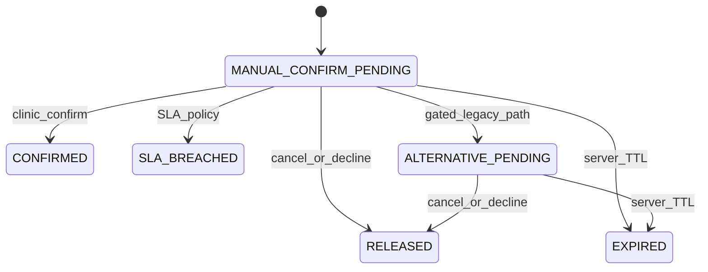
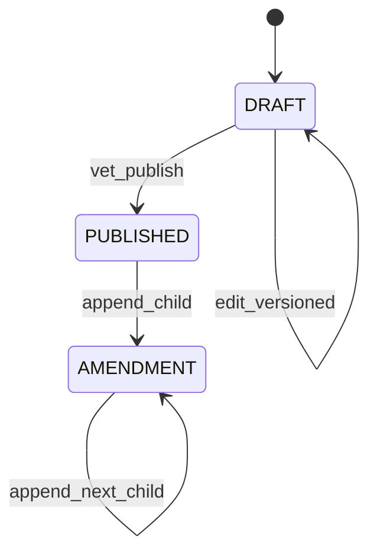

# 03 — Модели состояний, инварианты и переходы

**Contract:** `VETORA-STATE-001` · `v0.1.0` · `PROPOSED_FOR_PO_APPROVAL`. См. [границы доменов](../v50/adr/0001-domain-source-of-truth.md), [Booking Hold](../../backend/src/booking-core/booking.types.ts), [граф Hold](../../backend/src/booking-core/booking-state-machine.ts), [Appointment DTO](../../backend/src/booking-core/dto/clinic-appointment-detail.dto.ts) и [Clinical Result](../../backend/src/booking-core/clinical-result.service.ts).

**Важно:** здесь описывается существующая authority topology. YAML в `contracts/booking-machine.yaml` — справочник состояний, **не** генератор новой runtime state machine. Для любого изменения проверять fresh code + normative issue.

## Три независимых домена

1. **Slot/Hold** — техническое удержание вместимости, TTL, readback и совместимость legacy.
2. **Appointment** — бизнес-договорённость владельца и клиники, authoritative **после подтверждения**.
3. **Visit / Clinical Result** — фактически выполненная медицинская помощь и публикация заключения. Завершение слота и публикация результата — не одно событие.

### PILOT Hold projection

`ALTERNATIVE_PENDING` в текущем Hold enum есть, но это **не** автоматическое разрешение включать альтернативы в `PILOT_V1`. Existing hold transitions шире приведённого пилотного среза (MIS/payment/legacy). Не удалять их из кода и не делать достижимыми для нового UI без flags+контракта.

`MvpBookingStatus` — отдельная **публичная проекция**: `PENDING_CONFIRMATION`, `CONFIRMED`, `REJECTED`, `CANCELLED`, `EXPIRED`. `RELEASED` отображается как `REJECTED` **только если** доказан `clinicDeclined`, иначе `CANCELLED`; `EXPIRED` и `SLA_BREACHED` → `EXPIRED`; `COMPLETED` legacy hold → booking `CONFIRMED`, не автоматически «визит состоялся». Не показывать internal enum пользователю.

### Appointment lifecycle

Публичная проекция текущего Clinic Appointment Detail DTO содержит `SCHEDULED`, `COMPLETED`, `NO_SHOW`, `CANCELLED`, `UNKNOWN`. Исходная терминология Wave 2 (`CONFIRMED`, `CANCELLED_BY_USER`, `CANCELLED_BY_CLINIC`, `RESCHEDULE_PROPOSED`, `NO_SHOW`) остаётся `NOT_VERIFIED` как нормативный lifecycle: ссылки пакета на Wave 2 отсутствуют в этой ветке. Следующие инварианты остаются предложениями до сверки с применимой задачей и контрактом.

Инварианты:

- Клиника **предлагает** другое время; исходная подтверждённая Appointment остаётся прежней до **явного Owner accept**.
- Owner accept — атомарно переносит Appointment и capacity; reject/expiry не меняют старый слот.
- Owner/Clinic cancellation имеют разные причины/authority; late cancellation (граница `serverNow >= startsAt - 2h`) — лишь метка, не штраф.
- Состояние `NO_SHOW`, отмена и неразрешённый перенос запрещают нормальное завершение Visit.
- Lock order для подтверждённых lifecycle-команд: `hold -> Appointment -> sorted slots -> proposal`. Не делать network I/O в DB transaction.
- Idempotency: exact replay возвращает тот же результат, changed payload с тем же key — конфликт; все audit/outbox effects exactly-once per committed command.

### Visit / Clinical Result

Диаграмма отражает **Clinical Result** и последовательность Amendment, а не создаёт enum `AMENDMENT` для самого результата. Текущий сервис содержит `DRAFT`, `PUBLISHED` и отдельные amendments. Остальные условия предложения, включая персональное назначение врача, требуют сверки с конкретными guard, endpoint и нормативом перед использованием.

Старый `docs/v50/adr/0004-clinical-visit-state-machine.md` описывает **более широкий целевой** медицинский процесс (`NOT_STARTED/IN_PROGRESS/READY_TO_SIGN/SIGNED/AMENDED`). Его состояния **не** автоматически обязательны для первого пилота и **не** должны сливаться с текущей Wave 3 Clinical Result state machine без отдельного решения.

### Биллинг и CPA

Никакой технической state machine начисления CPA пока **не утверждено**. Не создавать статусы типа `CHARGEABLE`/`PAID` и таблицы, пока PO не определит доказательство первого визита, спорные случаи, корректировку и retention. Календарная дата не подтверждает визит.

## Обязательные отрицательные тесты при изменениях

Double booking, stale slot/version, concurrent booking, replay changed payload, foreign owner, cross-clinic/location, revoked/inactive membership, false confirmation after timeout, cancellation-vs-accept, no-show-vs-completion, draft visibility, published overwrite, duplicate amendment. Выбирать **только затронутые** элементы матрицы на итерации; full race/E2E suite — release или cross-domain gate.
